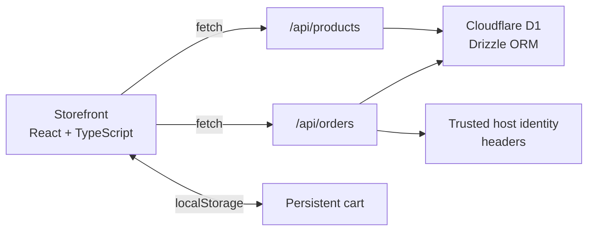

<div align="center">

# Atelier Commerce

### A thoughtful storefront, built from discovery to demo checkout.

An editorial e-commerce experience for **Luma Market** — a fictional shop for considered desk, audio, and everyday objects. Browse the collection, build a persistent bag, and place a database-backed demo order.

[Explore the screenshots](screenshots/task-4-commerce/README.md) · [API](#api) · [Run locally](#run-locally)


<br>


</div>

---

## The experience

Luma Market pairs a warm, product-led storefront with the essentials of a full-stack commerce flow. The interface is responsive and intentionally designed around a small collection of original CSS product illustrations.

| Discover | Shop | Checkout |
| --- | --- | --- |
| Search, filter by category, and explore product details in a quick view. | Keep a cart across reloads, adjust quantities, and see shipping and totals update. | Submit delivery details to save an order and update inventory — without collecting payment. |

### A closer look

<p align="center">
  
  
</p>
<p align="center">
  
  
</p>
<p align="center">
  
  
</p>

See the [complete feature screenshot index](screenshots/task-4-commerce/README.md) for all 19 documented states.

## Features

- Responsive product catalog with custom CSS artwork and product quick views
- Search and category filters, with loading, empty, and error states
- Persistent browser cart with stock-aware quantities and live order totals
- Free delivery at $150; otherwise a $12 delivery charge
- Validated demonstration checkout that stores orders and decrements inventory
- Order history scoped to the visitor identity supplied by the hosting environment
- Product and order REST API routes

## Built with

| Layer | Technology |
| --- | --- |
| UI | React 19, TypeScript, Tailwind CSS 4 |
| App routing | Vinext with a Next-compatible App Router |
| Runtime | Cloudflare Workers |
| Persistence | Cloudflare D1 and Drizzle ORM |
| Identity | Trusted ChatGPT Sites identity headers for hosted order history |

## Run locally

**Requirements:** Node.js `>=22.13.0` and npm.

1. Install dependencies:

   ```sh
   npm ci
   ```

2. Create the local hosting configuration from the safe template:

   ```sh
   # macOS / Linux
   cp .openai/hosting.example.json .openai/hosting.json
   ```

   ```powershell
   # Windows PowerShell
   Copy-Item .openai\hosting.example.json .openai\hosting.json
   ```

3. Start the development server:

   ```sh
   npm run dev
   ```

The storefront initializes its sample catalog on first load. The development runtime uses local Cloudflare tooling; its generated state stays in the ignored `.wrangler/` directory. The private `.openai/hosting.json` file is deliberately not tracked.

## Architecture



### API

| Route | Methods | Purpose |
| --- | --- | --- |
| `/api/products` | `GET` | Initialize the sample catalog when empty and return products |
| `/api/products` | `POST`, `PUT`, `DELETE` | Create, update, and delete catalog products |
| `/api/orders` | `POST` | Validate a demo checkout, save the order and line items, and update stock |
| `/api/orders` | `GET` | Return order history for the current host-provided identity |

## Scope and limitations

- **No payments:** Checkout is a demonstration flow. It stores an order, but never collects card details or processes a payment.
- **Demo data:** The catalog and screenshots use fictional products and sample delivery details.
- **Hosting identity:** There is no sign-up or sign-in UI. Hosted order history depends on trusted identity headers; the local fallback identity is only for development.
- **Not production-ready:** Product write endpoints do not implement an admin authorization layer. Add authorization and review deployment configuration before exposing write APIs to untrusted users.
- **Hosting setup:** A production Cloudflare D1 binding and host-specific configuration must be supplied by the deployment environment.

## Project

Built for **Task 4 — E-Commerce Website** in the Auspify Technologies Full Stack Development internship.
