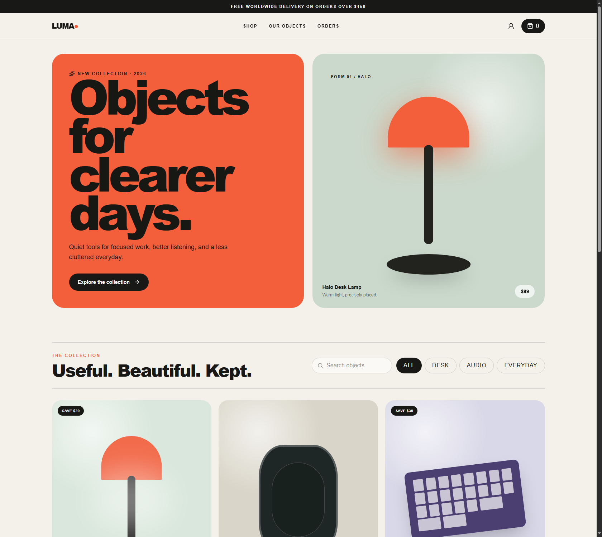
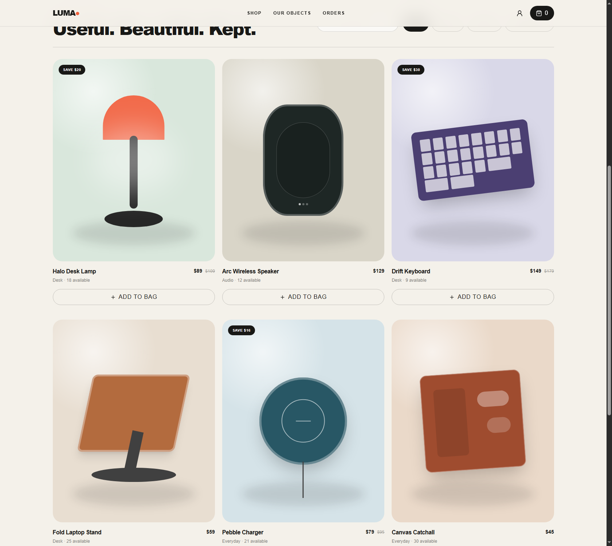
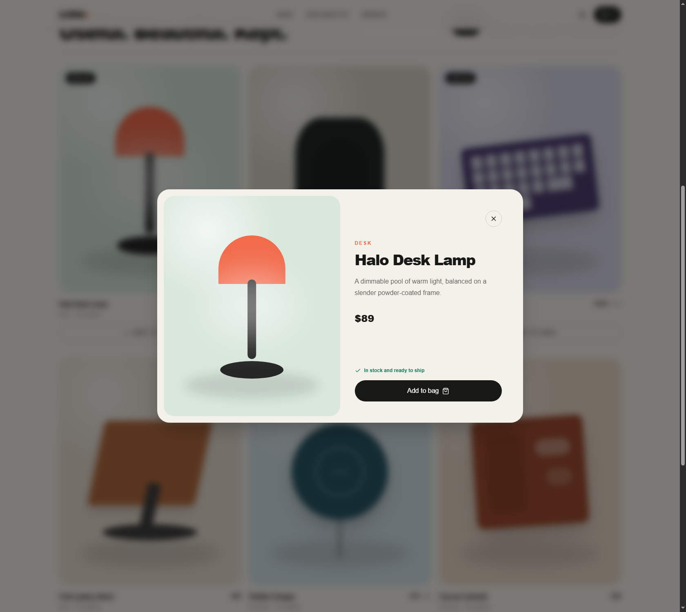
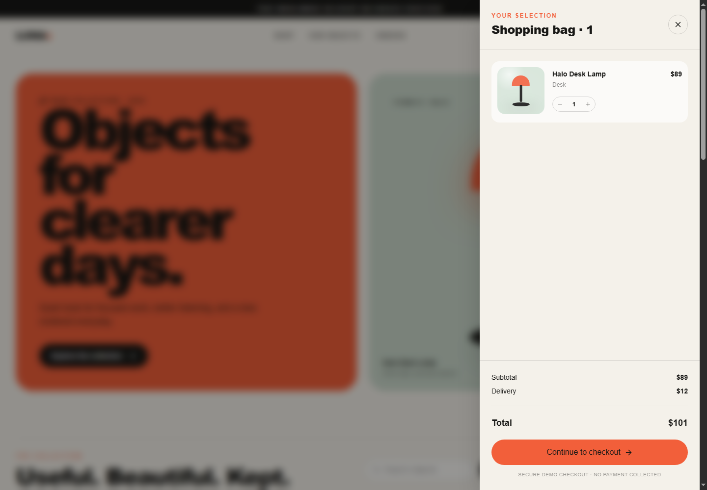
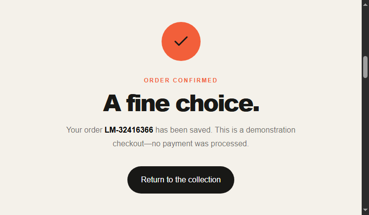
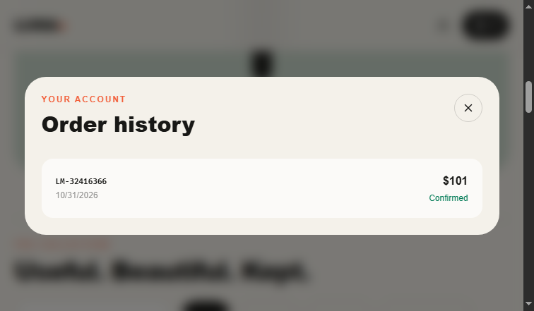
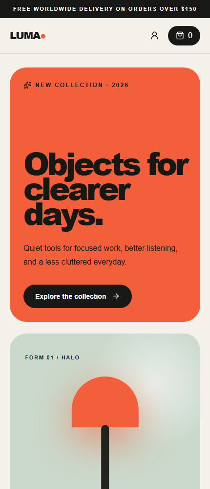
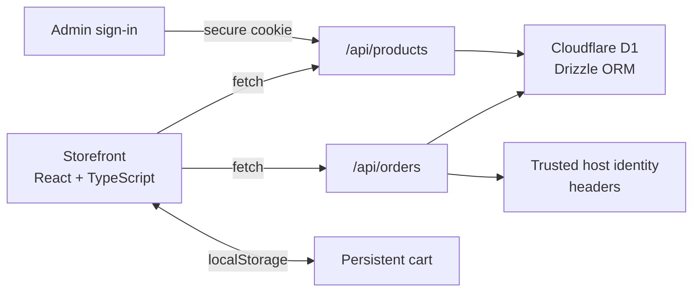

<div align="center">

# Atelier Commerce

### A thoughtful storefront, built from discovery to demo checkout.

An editorial e-commerce experience for **Luma Market** — a fictional shop for considered desk, audio, and everyday objects. Browse the collection, build a persistent bag, and place a database-backed demo order.

[Explore the screenshots](screenshots/task-4-commerce/README.md) · [API](#api) · [Run locally](#run-locally)



<br>


</div>

---

## The experience

Luma Market pairs a warm, product-led storefront with the essentials of a full-stack commerce flow. The interface is responsive and intentionally designed around a small collection of original CSS product illustrations.

| Discover | Shop | Checkout |
| --- | --- | --- |
| Search, filter by category, and explore product details in a quick view. | Keep a cart across reloads, adjust quantities, and see shipping and totals update. | Submit delivery details to save an order and update inventory — without collecting payment. |

### A closer look

<p align="center">
  
  
</p>
<p align="center">
  
  
</p>
<p align="center">
  
  
</p>

See the [complete feature screenshot index](screenshots/task-4-commerce/README.md) for all 19 documented states.

## Features

- Responsive product catalog with custom CSS artwork and product quick views
- Search and category filters, with loading, empty, and error states
- Persistent browser cart with stock-aware quantities and live order totals
- Free delivery at $150; otherwise a $12 delivery charge
- Validated demonstration checkout that stores orders and decrements inventory
- Order history scoped to the visitor identity supplied by the hosting environment
- Product and order REST API routes

## Built with

| Layer | Technology |
| --- | --- |
| UI | React 19, TypeScript, Tailwind CSS 4 |
| App routing | Vinext with a Next-compatible App Router |
| Runtime | Cloudflare Workers |
| Persistence | Cloudflare D1 and Drizzle ORM |
| Admin access | Runtime-only password and HMAC-signed secure session cookie |
| Order history | Hosting-provided identity headers; demo fallback locally |

## Run locally

**Requirements:** Node.js `>=22.13.0` and npm.

1. Install dependencies:

   ```sh
   npm ci
   ```

2. Create the local hosting configuration from the safe template:

   ```sh
   # macOS / Linux
   cp .openai/hosting.example.json .openai/hosting.json
   ```

   ```powershell
   # Windows PowerShell
   Copy-Item .openai\hosting.example.json .openai\hosting.json
   ```

3. Start the development server:

   ```sh
   npm run dev
   ```

Before starting, add these values to the ignored `.dev.vars` file in the repository root, replacing both placeholders with unique secrets:

   ```dotenv
   ADMIN_PASSWORD="<unique password, at least 16 characters>"
   ADMIN_SESSION_SECRET="<random secret, at least 32 bytes>"
   ```

Generate a signing secret with `openssl rand -base64 48`. Never commit `.dev.vars` or expose these values to browser code. The storefront initializes its sample catalog on first load. The development runtime uses local Cloudflare tooling; its generated state stays in the ignored `.wrangler/` directory. The private `.openai/hosting.json` file is deliberately not tracked.

## Architecture



### API

| Route | Methods | Purpose |
| --- | --- | --- |
| `/api/products` | `GET` | Initialize the sample catalog when empty and return products |
| `/api/products` | `POST`, `PUT`, `DELETE` | Create, update, and delete catalog products; requires a signed-in admin session |
| `/api/admin/session` | `GET`, `POST`, `DELETE` | Check, create, and clear the admin session |
| `/api/orders` | `POST` | Validate a demo checkout, save the order and line items, and update stock |
| `/api/orders` | `GET` | Return order history for the current host-provided identity |

Visit `/admin` to sign in. The password and session-signing key are read only from the Worker runtime environment (`ADMIN_PASSWORD` and `ADMIN_SESSION_SECRET`); there is no default password or public registration. Admin sessions are HMAC-signed, expire after eight hours, and use an `HttpOnly`, `Secure`, `SameSite=Strict`, host-only cookie. Catalog mutations additionally require a same-origin `Origin` header. Missing or weak secrets disable admin access rather than opening it.

For a Wrangler deployment, provision both values as Worker secrets (for example, `npx wrangler secret put ADMIN_PASSWORD` and `npx wrangler secret put ADMIN_SESSION_SECRET`). For other hosting control planes, configure them as runtime secrets on the Worker; do not put them in committed config or browser-exposed variables. Configure an edge rate limit for `POST /api/admin/session`, enforce HTTPS redirects, and enable HSTS before public deployment. The session cookie is always marked `Secure`.

## Scope and limitations

- **No payments:** Checkout is a demonstration flow. It stores an order, but never collects card details or processes a payment.
- **Demo data:** The catalog and screenshots use fictional products and sample delivery details.
- **Demo records only:** Checkout remains public and intentionally stores demonstration orders while decrementing sample inventory. Do not collect real customer records until customer authentication, order-ownership enforcement, and privacy controls are implemented and verified.
- **Hosting identity:** Order-history separation still depends on the hosting platform stripping client-supplied identity headers and injecting trusted values. The local fallback identity is shared and is not authentication; do not use it to store or expose real order records.
- **Deployment gate:** Admin writes fail closed without both runtime secrets, but this does not make the demo storefront production-ready. Configure strong secrets, rate limiting, HTTPS/HSTS, D1 access, and trusted identity handling in the target hosting environment before exposing it to real users.

## Project

Built for **Task 4 — E-Commerce Website** in the Auspify Technologies Full Stack Development internship.
